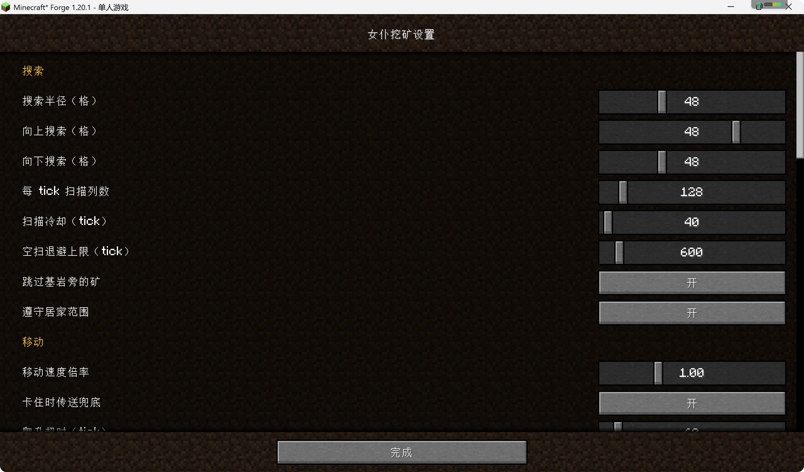
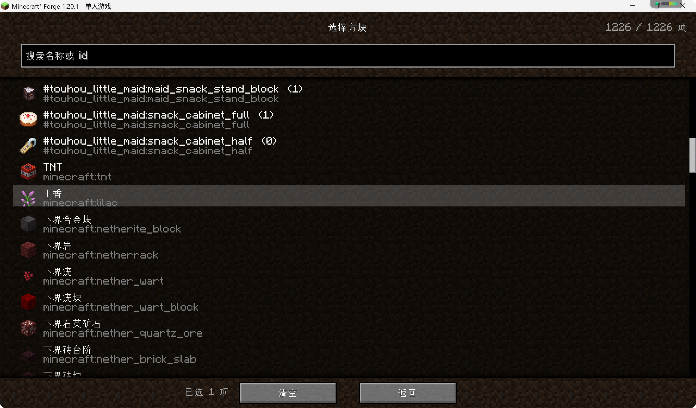

# Maid Mining


[](LICENSE)
[](#versions)
[](https://neoforged.net/)

**Maid Mining** is a [Touhou Little Maid](https://github.com/TartaricAcid/TouhouLittleMaid) extension mod that gives maids the ability to autonomously mine.

女仆挖矿扩展：给车万女仆新增「挖矿」工作模式，自动搜索目标方块、挖隧道抵达并采集。**目标方块与可用工具都可以在配置里自由增减**，出厂默认仍是「只挖矿石 + 任意镐子」。

This branch is the **Minecraft 1.21.1 / NeoForge** build. The feature set is identical to the 1.20.1 Forge build on `main`; only the platform APIs differ.

- 3×3 chunk search radius, with configurable reach
- Automatic tunnel digging to reach targets
- **Configurable tool & target lists** — ores only by default; add any mineable block or tool
- **A real in-game config screen** — sliders, toggles, and a searchable, icon-based list editor (no Cloth Config needed)
- **Enchanted pickaxes work as expected** — Fortune increases yield, Silk Touch keeps the block itself
- Cross-mod ore & pickaxe compatibility (ore/pickaxe tags, `modid:*` wildcards)



*The built-in config screen — **Mods → Maid Mining → Config**, no extra dependencies.*



*Picking target blocks by name or registry id, straight from the block registry.*

## Versions

The mod is maintained per Minecraft version, one branch each. Both branches ship the same feature set at the same mod version.

| Minecraft | Loader | Branch | Mod version | Java |
|-----------|--------|--------|-------------|------|
| **1.20.1** | Forge 47.4.22+ | [`main`](https://github.com/leyuezhida/maidmining/tree/main) | 1.1.0 | 17 |
| **1.21.1** | NeoForge 21.1.219+ | [`1.21.1-neoforge`](https://github.com/leyuezhida/maidmining/tree/1.21.1-neoforge) ← you are here | 1.1.0 | 21 |

Touhou Little Maid **1.5.3+** is required in both cases (matching loader — this branch needs `1.5.3-neoforge+mc1.21.1`).

## Installation

1. Install Minecraft 1.21.1 with **NeoForge 21.1.219+**
2. Drop [Touhou Little Maid](https://www.curseforge.com/minecraft/mc-mods/touhou-little-maid) `1.5.3-neoforge+mc1.21.1` and `maidmining-1.1.0.jar` into `mods/`
3. Launch, give a maid a pickaxe, and switch her task to **Mining**

Also on [CurseForge](https://www.curseforge.com/minecraft/mc-mods/maid-mining) and [MC百科](https://www.mcmod.cn/class/29632.html).

## Usage

1. Give your maid a **tool she accepts** — by default any pickaxe (enchanted ones are fine, see below)
2. (Optional) Put a **raw ore** (iron ore, raw iron, etc.) or **a block** in her **offhand** to target one type
3. Switch her task mode to **Mining**
4. She will search for targets and dig tunnels to reach them

### Configurable tools and targets

Still a mining task — what became configurable is which tools she accepts and which blocks
she is willing to mine. **Out of the box she mines ores only and uses any pickaxe**; everything
below is opt-in. Both sets are server-config lists, written as registry ids, `#tags`,
or wildcards (`some_mod:*` for a whole mod, `minecraft:*_ore` for a name pattern).

```toml
[tools]
    # Defaults to #minecraft:pickaxes, #forge:tools/pickaxes, #c:tools/pickaxes.
    whitelist = ["#minecraft:pickaxes", "minecraft:iron_shovel"]
    blacklist = ["minecraft:wooden_pickaxe"]
    requireCorrectTool = true

[targets]
    # ORES (default) / WHITELIST / ORES_AND_WHITELIST
    mode = "ORES_AND_WHITELIST"
    whitelist = ["minecraft:gravel", "minecraft:clay"]
    blacklist = ["minecraft:copper_ore"]
    offhandTargeting = true
```

That example keeps her mining ores, adds **gravel and clay** to the target list, ignores copper,
and lets her use a shovel: she re-picks the tool per target, so gravel is dug with the shovel
instead of a pickaxe that would yield nothing.

> `tools.whitelist` ships with the pickaxe tags, so anything you add is an **addition**.
> Once non-empty it does replace the built-in rule — but as long as a pickaxe tag stays in the
> list, modded pickaxes are still detected (`ItemAbilities` / "can harvest" fallbacks).
> Remove every pickaxe tag if you truly want only the listed items.
> Add `"some_mod:*"` or `"some_mod:*_pickaxe"` to accept tools from a mod without listing them one by one.

### Enchantments

Enchantments on the pickaxe behave the way they would for a player:

| Enchantment | Effect |
|-------------|--------|
| **Fortune** | Increases ore yield (Fortune III can yield up to 4×) |
| **Silk Touch** | Mining an ore yields the ore **block** instead of raw material — renewable, and usable as building material |
| **Efficiency** | No effect, by design: blocks break instantly (no mining-time simulation) |
| **Mending** | Nothing to repair, since durability is not consumed (see below) |

> The last two are **intentional design decisions**, not missing features. Instantaneous
> breaking keeps the maid's rhythm predictable and avoids half-dug states; not consuming
> durability means Mending has no purpose.

The maid **picks the best tool available for the current target**, scoring by mining enchantments, then tier, then remaining durability — a diamond pickaxe is preferred over a wooden one, and a Silk Touch pickaxe over a plain one of the same tier.

Mining does **not** wear out tools by default, since a maid is expected to keep mining indefinitely. If you want player-like wear, set `dig.damageTool = true`.

## Configuration

Configuration lives in `config/maidmining-common.toml` (41 options in nine groups: search, travel, dig, items, tools, targets, safety, diag, compat), and can be edited in-game via **Mods → Maid Mining → Config** — toggles, sliders, enums, and the tool/target lists (picked from a searchable list with icons) are all editable there. Defaults are deliberately conservative: no lava, no player-placed blocks, cheap scaffolding only, and the bedrock-adjacent-ore rule kept on.

| Option | Meaning |
|--------|---------|
| `tools.whitelist` | Tools she may use. Defaults to the pickaxe tags; keeping a pickaxe tag also keeps the built-in "any pickaxe" detection. Accepts ids, `#tags`, `mod:*`. |
| `tools.blacklist` | Tools she never uses; wins over the whitelist. |
| `tools.requireCorrectTool` | Keep the player-like "right tool for the block, right tier" rule (default on). |
| `targets.mode` | `ORES` (default) / `WHITELIST` / `ORES_AND_WHITELIST`. |
| `targets.whitelist` | Extra blocks to mine (`minecraft:gravel`, `minecraft:clay`, `minecraft:*_ore`...). |
| `targets.blacklist` | Blocks never targeted, even if a tag would include them. |
| `targets.offhandTargeting` | Let the offhand narrow the target (ore material or exact block). |
| `compat.fakePlayerMode` | `MAID` (default) keeps TLM's destruction path; `FAKE_PLAYER` routes breaking through a fake player so **land-claim / protection mods can intercept** it. |
| `search.skipNearBedrock` | Keeps her from locking onto ores next to bedrock, where she gets stuck. On by default. |

Config edits are hot-reloaded: the tool/target caches are invalidated on reload, so the next decision already uses the new lists — no restart, no re-summon.

## Building

```bash
./gradlew build                # jar in build/libs/
./gradlew runGameTestServer    # headless automated tests
./gradlew runClient            # dev client
```

Prerequisites:

- **JDK 21** (required by 1.21.1). `gradle.properties` pins
  `org.gradle.java.installations.paths` to a local JDK — change that line on another machine.
- `libs/touhoulittlemaid-1.5.3-neoforge+mc1.21.1.jar`, the compile-time TLM dependency.
  It is **not** committed (third-party artifact, large); see [`libs/README.md`](libs/README.md) for the download link.

The build uses ModDevGradle 2 with official Mojang mappings, so the TLM release jar is consumed
as a plain `implementation files(...)` dependency — no deobfuscation step.

Porting notes — what had to change from the 1.20.1 Forge code, file by file — are in
[`PORTING.md`](PORTING.md).

## License

This project is licensed under the **MIT License** — see [LICENSE](LICENSE) for details.

## Credits

- **leyue** - Author
- **Touhou Little Maid** - The amazing maid mod this extends
- **NeoForge** - Modding platform
